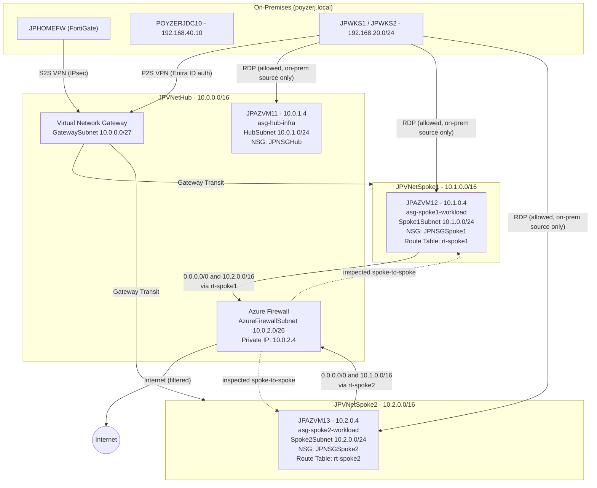

# Design Document: Securing the Hub-Spoke — AZ-500 Network Security Lab

**Prepared by:** Joe Poyzer
**Date:** August 16, 2026
**Environment:** `rg-az500-doit-cus` (Microsoft Azure)
**Reference:** See *Scope of Work — Securing the Hub-Spoke* for objectives, phase breakdown, and deliverables. This document details the technical design underlying each phase.

---

## 1. Design Principles

- **Deny-by-default, explicit allow.** Azure NSGs cannot be switched to a true default-deny posture — the platform's built-in `AllowVnetInBound` rule (priority 65000) permits all traffic within the VNet's address space, which for a peered hub-spoke topology includes both spokes. The design achieves deny-by-default by adding an explicit deny rule at a lower priority number (evaluated first) than the platform default, then layering narrow allow rules above it for exactly what's required.
- **Centralized inspection over implicit trust.** Spoke-to-spoke and spoke-to-internet traffic is redirected through Azure Firewall rather than relying on direct VNet peering or the Virtual Network Gateway as the path, so all lateral and outbound traffic is visible and filterable in one place.
- **Least privilege on management access.** RDP/SSH is scoped to the specific on-premises subnet administrators actually connect from, not the broader `VirtualNetwork` tag or `Any`.
- **No change to existing on-premises connectivity.** The Site-to-Site and Point-to-Site VPN paths built for AZ-700 are left as-is; this design only affects intra-Azure traffic patterns (spoke-to-spoke, spoke-to-internet) and management-port exposure.

## 2. Target Architecture

**What changes from the AZ-700 design:** spoke-to-spoke traffic previously routed through the Virtual Network Gateway via a UDR (`next hop = Virtual Network Gateway`) to work around VNet peering's lack of transitivity. This design replaces that UDR with `next hop = Azure Firewall`, so the same transitive routing problem is solved *and* that traffic is now inspected and logged rather than passing through uninspected.

## 3. IP Addressing — New Allocations

| Resource | Address space | Notes |
|---|---|---|
| `AzureFirewallSubnet` | `10.0.2.0/26` | New subnet in `JPVNetHub`; does not overlap `HubSubnet` (10.0.1.0/24) or `GatewaySubnet` (10.0.0.0/27) |
| Azure Firewall private IP | `10.0.2.4` | First usable address in the new subnet |
| Azure Firewall public IP | *(new Standard SKU public IP)* | Required for outbound SNAT; no inbound DNAT rules planned |

**Confirmed:** the Point-to-Site VPN client address pool uses a `172.16.x.x/24` range, which does not overlap `10.0.2.0/26` — no conflict with the new firewall subnet.

## 4. Application Security Groups

| ASG | Assigned to | Purpose |
|---|---|---|
| `asg-hub-infra` | `JPAZVM11` | Hub-resident infrastructure role |
| `asg-spoke1-workload` | `JPAZVM12` | Spoke 1 workload |
| `asg-spoke2-workload` | `JPAZVM13` | Spoke 2 workload |

With one VM per subnet today, ASGs don't reduce rule count much yet — the value is that NSG rules reference roles (`asg-spoke1-workload`) instead of hardcoded IPs, so the rules keep working unchanged if a subnet later hosts more than one VM per role.

## 5. NSG Rule Design

**Revised against the actual deployed state.** The base NSGs (created by `Deploy-AZ500-NSGs.ps1`) already exist with 4 rules each — `Allow-RDP-From-Hub` (100), `Allow-RDP-From-Home` (110), `Allow-Ping-From-Home` (120), `Allow-DNS-From-Home` (130) — sourced from both on-prem VLANs (`192.168.20.0/24` LAN and `192.168.40.0/24` servers), not just the LAN as originally drafted here. `Deploy-DNS-Forwarder-VM11.ps1` also confirms the actual DNS traffic direction: on-prem DC forwards **to** `JPAZVM11`, which relays to Azure's internal DNS (`168.63.129.16`) — not spokes querying the hub, as originally assumed. The spoke-facing DNS rule drafted in the prior revision of this document was based on that incorrect assumption and has been removed.

Decisions confirmed for Phase 1:
- **Keep** `Allow-Ping-From-Home` on all three NSGs (useful for troubleshooting, not worth trimming)
- **Keep** `Allow-RDP-From-Hub` on both spokes (hub-as-jumpbox pattern, in addition to direct `Allow-RDP-From-Home`) — the hub is equally locked down, so this doesn't weaken least privilege
- **Remove** `Allow-DNS-From-Home` from the spoke NSGs only — it's genuinely unused there per the original script's own comment, kept only on `JPNSGHub` where it's actually needed
- **Retarget destinations** on all kept rules from `*` to the matching ASG (`asg-hub-infra` / `asg-spoke1-workload` / `asg-spoke2-workload`), consistent with the SOW's commitment to role-based rules over hardcoded targets
- **Add** an explicit low-priority deny for intra-VNet traffic on all three NSGs, overriding the platform default `AllowVnetInBound` (priority 65000) that currently allows unrestricted spoke-to-spoke and hub-to-spoke traffic

### JPNSGHub (HubSubnet)

| Priority | Name | Direction | Source | Destination | Port | Action |
|---|---|---|---|---|---|---|
| 100 | Allow-RDP-From-Hub | Inbound | 10.0.0.0/16 | asg-hub-infra | 3389/TCP | Allow *(unchanged)* |
| 110 | Allow-RDP-From-Home | Inbound | 192.168.20.0/24, 192.168.40.0/24 | asg-hub-infra | 3389/TCP | Allow — destination retargeted to ASG |
| 120 | Allow-Ping-From-Home | Inbound | 192.168.20.0/24, 192.168.40.0/24 | asg-hub-infra | ICMP | Allow — destination retargeted to ASG |
| 130 | Allow-DNS-From-Home | Inbound | 192.168.20.0/24, 192.168.40.0/24 | asg-hub-infra | 53/TCP,UDP | Allow — destination retargeted to ASG |
| 4000 | Deny-VirtualNetwork-Inbound | Inbound | VirtualNetwork | VirtualNetwork | Any | Deny (new) |
| 4010 | Deny-Internet-Inbound | Inbound | Internet | Any | Any | Deny (new) |

### JPNSGSpoke1 (Spoke1Subnet)

| Priority | Name | Direction | Source | Destination | Port | Action |
|---|---|---|---|---|---|---|
| 100 | Allow-RDP-From-Hub | Inbound | 10.0.1.0/24 | asg-spoke1-workload | 3389/TCP | Allow — destination retargeted to ASG |
| 110 | Allow-RDP-From-Home | Inbound | 192.168.20.0/24, 192.168.40.0/24 | asg-spoke1-workload | 3389/TCP | Allow — destination retargeted to ASG |
| 120 | Allow-Ping-From-Home | Inbound | 192.168.20.0/24, 192.168.40.0/24 | asg-spoke1-workload | ICMP | Allow — destination retargeted to ASG |
| 4000 | Deny-VirtualNetwork-Inbound | Inbound | VirtualNetwork | VirtualNetwork | Any | Deny (new) |
| 4010 | Deny-Internet-Inbound | Inbound | Internet | Any | Any | Deny (new) |

*(`Allow-DNS-From-Home` removed — unused on this NSG.)*

### JPNSGSpoke2 (Spoke2Subnet)

Same pattern as JPNSGSpoke1, sourced from `10.0.1.0/24` (hub subnet) for the jump-host rule, `asg-spoke2-workload` as destination throughout, DNS rule removed.

**Note:** the `Deny-VirtualNetwork-Inbound` rule is what actually removes the current implicit spoke-to-spoke and hub-to-spoke trust — the existing allow rules only ever covered RDP/ICMP/DNS from specific sources, but the platform default `AllowVnetInBound` was still open underneath them for everything else. Outbound rules are left at platform defaults (`AllowVnetOutBound`, `AllowInternetOutBound`) since Phase 2's UDR changes — not NSGs — are what redirect outbound traffic through the firewall for inspection.

## 6. Azure Firewall Design

- **SKU:** Standard (Premium's IDPS/TLS inspection was scoped out as a stretch goal, not core scope)
- **Deployment model:** Firewall Policy (not classic rules), managed through Firewall Manager
- **Public IP:** Standard SKU, required for SNAT'd outbound traffic

**Rule Collection Group: `rcg-spoke-egress`** (priority 200)

| Collection | Type | Priority | Rule |
|---|---|---|---|
| `net-allow-required` | Network | 100 | Source: `10.1.0.0/16`, `10.2.0.0/16` → Dest: `*` : `443` (baseline HTTPS egress) |
| `app-allow-updates` | Application | 200 | Source: `10.1.0.0/16`, `10.2.0.0/16` → FQDN Tag: `WindowsUpdate` |

- **Threat Intelligence:** Alert mode initially (not Deny) — validate for false positives against normal lab traffic before tightening to Alert and Deny.
- **DNAT rules:** none — no inbound internet access to spoke VMs is required.
- **Traffic explicitly not routed through the firewall in this design:** on-premises-bound traffic from the spokes continues to use the existing Gateway Transit path (unchanged from the AZ-700 design), not the firewall. This keeps the change set scoped to spoke-to-spoke and spoke-to-internet, per the SOW.

## 7. Route Table / UDR Design

| Route Table | Associated Subnet | Route Name | Address Prefix | Next Hop Type | Next Hop |
|---|---|---|---|---|---|
| `rt-spoke1` | Spoke1Subnet | to-Internet | 0.0.0.0/0 | Virtual Appliance | 10.0.2.4 |
| `rt-spoke1` | Spoke1Subnet | to-Spoke2 | 10.2.0.0/16 | Virtual Appliance | 10.0.2.4 |
| `rt-spoke2` | Spoke2Subnet | to-Internet | 0.0.0.0/0 | Virtual Appliance | 10.0.2.4 |
| `rt-spoke2` | Spoke2Subnet | to-Spoke1 | 10.1.0.0/16 | Virtual Appliance | 10.0.2.4 |

**Why the explicit `/16` routes matter:** Azure resolves routing by longest-prefix match, and prefers a user-defined route over a system route of equal specificity. Without the explicit `10.2.0.0/16 → Firewall` route, the automatically-created peering system route (also `/16`) would continue to win, and spoke-to-spoke traffic would silently bypass the firewall entirely despite the `0.0.0.0/0` default route being in place.

`Route Propagation` remains **enabled** on both route tables so on-premises routes learned via the S2S VPN still populate — this design doesn't change that.

## 8. Validation / Test Plan (maps to SOW Phase 4)

| # | Test | Tool | Expected Result |
|---|---|---|---|
| 1 | Effective route from JPAZVM12 to `10.2.0.4` | Network Watcher → Next Hop | `nextHopType: VirtualAppliance`, `nextHopIpAddress: 10.0.2.4` (confirms UDR beats system peering route) |
| 2 | Outbound from JPAZVM12 to `8.8.8.8:443` | IP Flow Verify | Allow (routed via firewall, permitted by `net-allow-required`) |
| 3 | Inbound RDP to JPAZVM12 from a non-on-prem source | IP Flow Verify | Deny (blocked by `Deny-VirtualNetwork-Inbound` / `Deny-Internet-Inbound`) |
| 4 | Inbound RDP to JPAZVM12 from `192.168.20.x` | IP Flow Verify | Allow |
| 5 | NSG Flow Logs review | Traffic Analytics / raw logs | Denied spoke-to-spoke attempts visible in logs, confirming rule 4000 is actually being hit, not just configured |

## 9. DDoS Protection Decision Framework (maps to SOW Phase 5)

Unlike a fully private environment, this design does introduce two internet-facing public IPs: the existing Virtual Network Gateway and the new Azure Firewall. That means DDoS Protection Standard's value proposition isn't moot here — the decision is a genuine cost/benefit call, not a formality.

| Factor | Basic (free, always on) | Standard (~$3,000/month) |
|---|---|---|
| Coverage | Platform-level, always on, no configuration | Adaptive tuning, attack analytics/alerting, cost protection guarantee, WAF integration |
| Applies to | All public IPs automatically | Public IPs in a protected VNet |
| Fit for this environment | Provides baseline protection for the Gateway and Firewall public IPs already | Cost isn't justified for a two-public-IP personal lab with no production traffic or SLA commitments |

**Design recommendation:** document Standard's incremental capabilities for the writeup, but do not enable it — Basic tier's baseline protection is a reasonable match for a personal lab's actual risk profile. This is a recommendation for the build phase to confirm, not a final decision made here.

## 10. Open Items

1. ~~Point-to-Site VPN client address pool — confirm no overlap with `10.0.2.0/26`~~ **Resolved:** pool is `172.16.x.x/24`, no overlap.
2. ~~Whether `JPAZVM11` actually serves a DNS-forwarder role~~ **Resolved:** confirmed via `Deploy-DNS-Forwarder-VM11.ps1` — on-prem DC forwards to `JPAZVM11`, which relays to Azure's internal DNS. Section 5 corrected accordingly.
3. ~~Keep or remove `Allow-Ping-From-Home`~~ **Resolved:** keep, on all three NSGs.
4. ~~Keep or trim the hub-as-jumpbox `Allow-RDP-From-Hub` path on the spokes~~ **Resolved:** keep both paths.
5. Whether hub-originated traffic (from `JPAZVM11`) should also route through the firewall for symmetry — out of scope per the SOW as written, flagged here in case that changes
